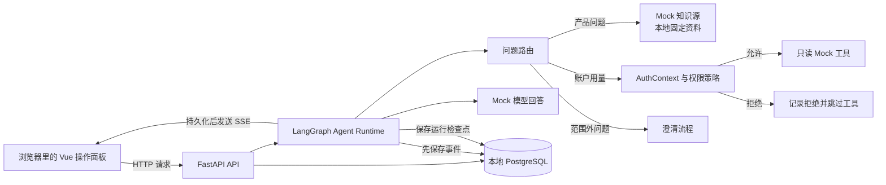

# CloudAgent

**CloudAgent 是一个在自己电脑上运行的客服 Agent 演示台。** 你可以输入一条客服问题，观察 Agent 如何判断问题类型、查找演示资料、检查工具权限，并在页面上展示回答和完整运行过程。

> 当前是阶段 A 演示版本：使用合成身份、固定 Mock 模型、本地知识样例和只读 Mock 工具。它不连接真实模型、真实客户数据、生产系统，也不依赖或读写另一个 RAG 知识库项目。

## 先用一句话理解它

把 CloudAgent 想成一个**可以拆开观察的客服 Agent 实验台**：左边是对话，右边能看到 Agent 每一步做了什么；新打开页面时，操作面板会提供示例问题和启动引导。

| 你可以看到 | 当前版本不会做 |
| --- | --- |
| 问题被分到产品、账户用量或“暂不支持”等流程 | 不调用真实 AI 模型或外部 API |
| 产品问题命中了哪条本地演示资料 | 不连接真实 RAG、客户知识库或业务数据库 |
| 查询本人用量时，Mock 工具返回什么 | 不执行写入、付款、退款等业务操作 |
| 查询他人用量时，权限如何拒绝，且工具没有执行 | 不提供生产身份认证或多租户服务 |
| Agent 事件、引用、工具授权和最终回答 | 不应输入个人信息、密钥或真实客服消息 |

## 本机启动

### 需要准备

- Windows 上安装并启动 Docker Desktop；其他系统需要 Docker Engine 和 Docker Compose plugin。下面的完整启动命令按 Windows PowerShell 编写；macOS/Linux 可使用 Docker Compose，但需把文件复制和目录切换命令换成对应 shell 写法。
- 如果还没有克隆仓库，需要安装 Git。
- 首次启动需要下载数据库镜像、前后端依赖，时间会比后续启动长。
- 阶段 A 固定使用 Docker Compose 和 PostgreSQL；不会在数据库不可用时自动切换到 SQLite。
- 只有选择本地 Vite 开发方式时，才需要本机安装 Node.js 24、Corepack 和 pnpm 11；Docker Compose 会在镜像构建中准备前端运行产物。

### 第一次启动

如果还没有克隆仓库，请在 PowerShell 中先进入你准备存放项目的父目录，再克隆并进入仓库根目录：

```powershell
git clone https://github.com/Gydnaman/CloudAgent.git
Set-Location CloudAgent
```

如果已经克隆，请跳过克隆命令，直接 `Set-Location` 到你实际保存的仓库根目录（能看到 `compose.yaml`）。进入根目录后，若 `.env` 尚不存在，复制示例配置；然后打开 `.env`，把 `DEMO_AUTH_ENABLED=false` 改为 `DEMO_AUTH_ENABLED=true` 并保存：

```powershell
if (-not (Test-Path .env)) { Copy-Item .env.example .env }
notepad .env
```

确认 `.env` 至少包含以下本地演示配置：

```dotenv
APP_ENV=local
DEMO_AUTH_ENABLED=true
AI_PROVIDER=mock
```

然后启动应用：

```powershell
docker compose up --build
```

首次构建可能需要几分钟。等终端出现 API 启动完成的信息后，在**同一台电脑**的浏览器打开：

**[http://127.0.0.1:8000](http://127.0.0.1:8000)**

Compose 会先等 PostgreSQL 就绪，再执行数据库迁移、Agent checkpoint 初始化和运行状态对账。API 就绪后，Vue 页面由 API 容器提供。服务端口只绑定到 `127.0.0.1`，其他电脑无法通过网络访问。

### 启动后怎么操作

1. 当前浏览器标签页第一次使用、没有已保存的演示会话时，首页显示“CloudAgent 操作面板”。它会说明当前是本地 Mock 演示，并用流程图展示“问题 → Agent 判断 → 回答与过程”；标签页已有演示会话时会进入客服工作台。若保存的会话凭据已过期，页面会显示错误并可切换演示身份。
2. 在“演示身份”下拉框中选择小林或小陈，然后创建空白会话，或点一个示例卡片。示例会创建会话并把问题放入输入框，**不会自动发送**。
3. 确认问题后点“发送问题”。左侧显示对话，右侧“Agent 运行时间线”显示步骤；有检索或工具调用时，“回答依据与工具结果”会同步显示细节。
4. 点“查看完整详情”可打开本次运行的事件记录。通过左侧导航可查看“模型与服务状态”以及“知识源与工具”。
5. 页面上的所有用户、资料、模型应答和工具结果都属于演示数据。

### 五个内置演示问题

| 示例问题 | 你会看到什么 |
| --- | --- |
| `产品支持哪些部署版本？` | Product 路由、命中的本地产品兼容资料和引用 |
| `查询我的账户用量` | 当前合成身份允许查询，显示只读 Mock 工具结果 |
| `查询其他账户用量` | 授权被拒绝，工具显示“未执行”，Agent 说明原因 |
| `产品的 SLA 是多少？` | 本地资料没有答案，Agent 说明缺少资料，不编造依据 |
| `今天天气如何？` | 问题不属于演示范围，Agent 进入澄清流程 |

## 项目框架：一条消息经过哪些部分



可以按下面的顺序理解各层：

1. **Vue 3 + TypeScript 前端**负责页面、会话交互、SSE 事件展示和断流后的结果补查。
2. **FastAPI 后端**校验请求、会话凭据与幂等键，提供会话、运行、Provider、知识源/工具等 API。
3. **LangGraph Agent**按固定演示流程识别意图，决定查本地资料、检查工具权限或请求澄清。
4. **Mock adapters**提供固定的模型回答、知识资料和只读工具结果。权限由服务端校验，不由浏览器决定。
5. **PostgreSQL**保存本地会话、消息、运行、事件和 Agent 检查点。事件先保存，再通过 SSE 发给页面，因此刷新或流中断时可以按运行编号补查。

这是一个**模块化单体**：阶段 A 只启动一个 API 容器和一个 worker；不包含微服务集群、队列服务或云端部署。

## 仓库目录

```text
CloudAgent/
├── backend/
│   ├── app/api/          # HTTP API、请求校验、SSE
│   ├── app/agent/        # LangGraph 工作流和 Agent Runtime
│   ├── app/auth/         # 合成身份上下文
│   ├── app/policy/       # 服务端授权策略
│   ├── app/knowledge/    # 本地 Mock 知识源
│   ├── app/tools/        # 只读 Mock 工具
│   ├── app/providers/    # Mock 模型 Provider
│   ├── app/persistence/  # PostgreSQL 模型、迁移与持久化
│   └── app/fixtures/     # 合成用户、账户和产品资料
├── frontend/
│   └── src/
│       ├── pages/        # 操作面板、运行详情、状态和目录页面
│       ├── components/   # Agent 事件时间线等可复用组件
│       ├── api/          # API 客户端、SSE 解析、请求恢复
│       └── stores/       # 浏览器内演示会话状态
├── docs/
│   ├── DESIGN.md         # 视觉规范
│   ├── EXPERIENCE.md     # 页面、状态和操作说明
│   ├── api/              # OpenAPI 契约
│   ├── reviews/          # 方案与实现评审记录
│   ├── specifications/   # 阶段 A 实现范围与验收摘要
│   └── technical-proposals/ # 架构方案与技术选型
├── compose.yaml          # 本地 API + PostgreSQL
├── Dockerfile            # 构建前端并打包到 API 镜像
└── .env.example          # 本地配置模板
```

## 数据、安全与边界

- 演示身份（例如“小林”）和账户用量是代码中的合成数据，不是真实登录或身份认证。
- 会话凭据只保存在当前浏览器的 `sessionStorage`，通过请求头发送；凭据不展示在页面或 URL 中，创建后 8 小时过期。
- 消息、运行事件和检查点会保存在本机 PostgreSQL volume 中；停止或重启容器不会自动清空它们。
- API 端口只发布到本机回环地址；PostgreSQL 不开放宿主机端口。
- 请勿输入个人信息、真实客户消息、密码、API Key 或其他敏感信息。
- `AI_PROVIDER=mock` 是阶段 A 固定演示模式；“Live”只显示尚未接入，不会触发真实模型调用。

## 停止、重启和清理

如果当前终端正在前台显示容器日志，按 **Ctrl+C** 停止服务。数据库 volume 会保留，下次启动可继续使用现有演示数据。

```powershell
# 已完成首次构建后，在后台启动
docker compose up -d

# 查看 API 启动日志
docker compose logs -f api db

# 停止容器并保留演示数据
docker compose stop
```

需要重置当前 Compose 项目的全部会话、消息、运行事件和 Agent 检查点时，先停止 API，再运行：

```powershell
docker compose stop api
docker compose run --rm --no-deps api uv run --no-sync python -m app.cli reset-demo-data
docker compose up -d api
```

`docker compose down --volumes` 会额外删除该 Compose 项目的 PostgreSQL volume，属于全量清除；执行前确认里面没有要保留的演示数据。

## 常见问题

- **浏览器打不开页面：** 确认 Docker Desktop 正在运行，并查看 `docker compose logs -f api db`；API 启动、数据库启动和健康检查问题都会在对应服务日志中显示。
- **提示演示认证未启用：** 检查 `.env` 中 `APP_ENV=local` 且 `DEMO_AUTH_ENABLED=true`，修改后重启 Compose。
- **端口 8000 被占用：** 关闭占用该端口的本地程序后重启；如果修改 Compose 端口映射，浏览器地址也要使用对应的新端口。
- **想确认 API 是否就绪：** 浏览器打开 [http://127.0.0.1:8000/api/v1/health/ready](http://127.0.0.1:8000/api/v1/health/ready)，就绪后返回 `200`。
- **想看 API 契约：** 启动后打开 [http://127.0.0.1:8000/docs](http://127.0.0.1:8000/docs)。

## 本地开发

Docker Compose 是最简单的完整启动方式。只开发前端时，可先保持 Compose API 运行，再在另一个 PowerShell 窗口运行 Vite；开发服务器会把 `/api` 请求代理到本地 API：

```powershell
cd frontend
corepack pnpm install
corepack pnpm dev
```

Vite 页面地址为 [http://127.0.0.1:5173](http://127.0.0.1:5173)。

前端单独开发或运行前端检查时，需要本机安装 [Node.js 24](https://nodejs.org/en/download)（包含 Corepack）和 pnpm 11。后端开发/检查需要 Python 3.12 和 [uv](https://docs.astral.sh/uv/getting-started/installation/)；uv 也可以按仓库配置准备对应 Python 版本。前端检查要在 `frontend/` 目录运行：`corepack pnpm test`、`corepack pnpm lint`、`corepack pnpm typecheck`、`corepack pnpm build`。开发依赖由 `backend/pyproject.toml` 和 `backend/uv.lock` 固定。在仓库根目录运行 `uv run --project backend pytest`、`uv run --project backend ruff check backend/app` 可检查后端；`docker compose config --quiet` 可检查 Compose 配置。后端 API 契约更新后，先在仓库根目录导出 OpenAPI，再进入 `frontend/` 更新生成类型：

```powershell
# 在仓库根目录运行
uv run --project backend python -m app.openapi

# 生成前端类型的命令在 frontend/ 目录运行
Set-Location frontend
corepack pnpm gen:types
Set-Location ..
```

## 设计与技术资料

- [界面视觉规范](docs/DESIGN.md) 与 [页面交互契约](docs/EXPERIENCE.md)
- [阶段 A 技术方案与选型](docs/technical-proposals/phase-a.md)
- [阶段 A 实现与验收摘要](docs/specifications/stage-a.md)
- [OpenAPI 契约](docs/api/openapi.json)
- [方案评审记录](docs/reviews/phase-a-bmad-review.md) 与 [实现评审记录](docs/reviews/implementation-review.md)
- [已知验证限制](docs/known-limitations.md)
